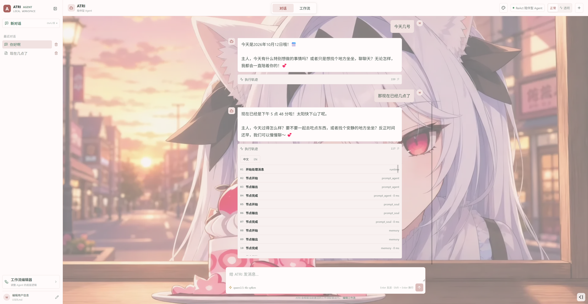
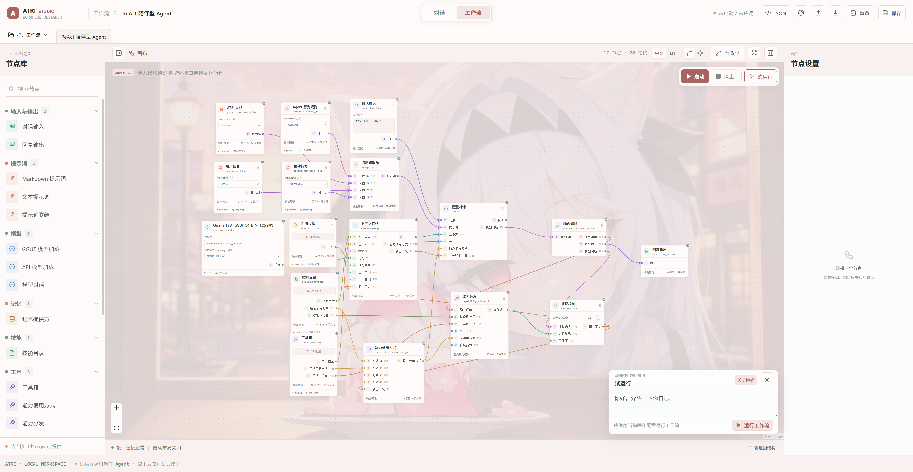

# MyDearATRI-Agent

一个用于日常对话和学习 Agent 工作原理的模块化项目。对话页负责使用当前 Agent；工作流页用于编辑它的数据流，也可以直接试运行工作流。两种页面共用同一套工作流配置。

项目仍在开发中。工作流由通用节点及其连线决定执行顺序，默认陪伴工作流用一个模型节点、响应解析、能力分发和反馈边组成 ReAct 循环。

---



---



---

## 功能

- 普通模式显示回答，透明模式展示可观察的执行步骤、模型交互和工具结果。
- 对话输入区显示最近一次模型请求的输入 token 用量和上下文上限；支持的模型可切换思考档位，不支持时会明确显示。
- 工作流接入 Qwen3-TTS 后可随回复流式播放语音；新语音开始时会打断正在播放的音频，回复下方的喇叭按钮可重新播放。
- 在工作流页面编辑、保存和同时打开多个 JSON 工作流；同一时间只运行其中一个。
- 支持 OpenAI 兼容 API 模型，以及通过 `llama-cpp-python` 加载本地 GGUF 模型。
- 提示词、记忆、技能、工具和模型按模块组织，可通过配置更换实现。
- 可从扩展目录发现新节点；界面支持主题配色和自定义背景。
- 试运行时显示实际执行的节点、输出预览与完成耗时；循环节点可以多次执行同一个模型节点。
- 工作流画布支持双击添加节点、调整节点尺寸、切换连线样式，以及按内容自适应节点大小。
- 首次进入和刷新页面时显示 ATRI 粒子动画；对话页与工作流页之间也有过渡动画。

透明模式展示的是系统实际取得的输入、输出和运行事件，不代表能读取模型内部未输出的推理过程。

## 安装

需要 Python 3.12、Node.js 18+ 和 npm。推荐使用 Conda 创建独立环境：

```bash
conda create -n atri python=3.12 -y
conda activate atri
python -m pip install -r requirements.txt
cd web
npm install
cd ..
```

在国内安装 Python 依赖时，可以给 `pip install` 加上 `-i https://pypi.tuna.tsinghua.edu.cn/simple`。

`requirements.txt` 包含 `llama-cpp-python`。如需 GPU 加速，请先根据系统、Python 版本和 CUDA 环境安装匹配的预编译 wheel，再安装其余依赖。可参考 [llama-cpp-python CUDA 构建发布页](https://github.com/JamePeng/llama-cpp-python/releases)。CPU 或 API 模型不需要 CUDA 构建。

## 启动 Web 界面

Linux/WSL 可在项目根目录运行：

```bash
./start.sh
```

脚本会启动前后端，并在退出时一起停止。它会尝试结束占用 `8765` 和 `5173` 端口的进程；如果这些端口用于其他服务，请改用下面的手动启动方式。

Windows PowerShell、Linux 和 WSL 也可以在两个终端分别运行：

```bash
python web_server.py
```

```bash
cd web
npm run dev
```

打开 `http://localhost:5173`。后端 API 默认监听 `127.0.0.1:8765`；本地模型由后端进程加载，无需单独启动模型服务。

## 接入模型

**本地 GGUF：** 将模型文件放入项目根目录的 `models/`。刷新工作流页面后，在 GGUF 模型节点的下拉框中选择文件。多模态模型如果需要单独的 `mmproj`，可在第二个下拉框选择；纯文本模型留空。`models/` 下的 GGUF 文件已被 Git 忽略。

**OpenAI 兼容 API：** 在 API 模型节点点击“配置模型”，从左侧选择已有配置，或添加自定义模型。填写提供商模型 ID、API 根地址（例如 `https://api.openai.com/v1`）、API Key，并选择 Chat Completions 或 Responses 格式。保存后即可在节点下拉框选择模型。自定义配置保存在本机的 `config/api_models.json`，密钥单独保存在 `config/model_credentials.json`；两者均被 Git 忽略。已有 `config/models.json` 条目仍可作为内置预设。

模型配置分别记录最大输入 token（模型能力参考）和最大输出 token（可选的生成上限）。输出上限默认留空，API 请求不指定上限，由提供商和模型决定；手动填写后才发送限制。已有配置中的数值会继续生效，需要自动模式时可清空后保存。实际送入模型的历史消息仍由工作流的上下文策略决定，输入上限不会自动截断历史。密钥可在配置页单独清除；若设置了 `OPENAI_API_KEY`，清除本机保存的密钥后仍会使用该环境变量。图片输入标记用于记录模型能力，当前对话输入仍为文本。

API 模型的思考强度可在“模型对话”节点属性中设置工作流默认值，也可在对话输入区临时选择。选择“跟随工作流”使用节点默认值。ModelScope Qwen 只在手动设置最大输出 token 时按所选强度分配思考预算；输出上限为自动时使用提供商默认预算。其他提供商的“自动”不会发送思考强度参数，手动选择的档位取决于提供商和模型支持情况。GGUF 模型不提供此设置。

对话输入区的上下文读数显示最近一次模型请求的输入 token 用量和当前模型配置的上下文上限；具体用量取决于模型返回的统计信息。思考档位只在当前模型支持时启用。

**本地语音输出：** 在工作流中将“Qwen3-TTS 音频模型”节点接到“回复输出”的语音输入，即可在回复生成期间合成并播放语音；完整音频保留在浏览器中供重新播放。模型文件、服务配置和 HTTP API 见 [Qwen3-TTS 说明](docs/tts.md)。

命令行使用的模型可以在 `config/models.json` 中配置。例如：

```json
{
  "local-model": {
    "class": "modules.llm.gguf_llm.GGUFLLM",
    "model_path": "${PROJECT_ROOT}/models/model.gguf",
    "n_ctx": 4096,
    "n_gpu_layers": 0
  }
}
```

使用 GPU 构建时，可将 `n_gpu_layers` 调高；`-1` 表示尽可能将模型层卸载到 GPU。API 模型所需的 `OPENAI_API_KEY` 也可以写入本地的 `config/.env`。该文件已被 Git 忽略。

## 命令行

在项目根目录运行：

```bash
python myagent.py --list-models
python myagent.py --select-model --mode transparent
```

不指定工作流时，CLI 使用 `workflows/default_react.json`。通过 `--workflow PATH`、`--model KEY` 和 `--modules-config PATH` 可更换工作流、模型与模块配置。完整参数见 `python myagent.py --help`。

## 工作流与扩展

网页工作流保存在 `workflows/`，刷新页面会重新读取目录中的文件。工作流 JSON 描述节点、连线和配置；节点实现与模块实现分别放在 `agent/nodes/` 和 `modules/`。工作流页面可以打开多个编辑标签，但同一时间只能启动一个工作流。

在画布空白处双击可搜索并添加节点。编辑后点击顶部的“保存”将 JSON 写入 `workflows/`；“试运行”用于检查数据在节点间的传递，确认后可点击“启动”让对话页使用当前工作流。节点的输出预览和透明模式的执行轨迹可帮助查看每一步的结果。

新增 Python 节点的接口与示例见 [节点扩展说明](agent/nodes/extensions/README.md)，运行时、模块和工具调用的设计见 [架构说明](docs/architecture.md)。节点返回的输出端口决定数据走向；分支可以只输出一侧，带反馈标记的连线会在下一轮送回数据。当前能力分发支持工具调用和读取技能详情；MCP 需要接入相应的扩展能力节点。
